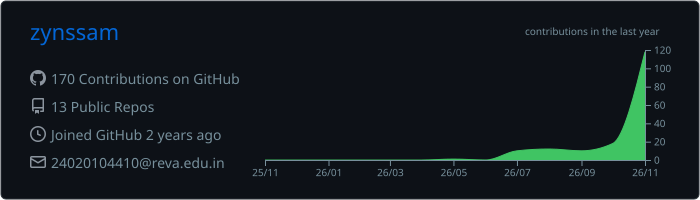
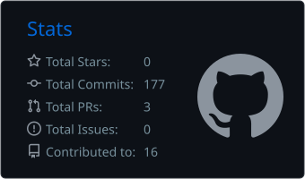
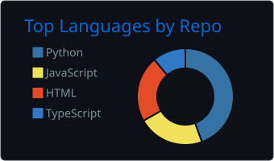
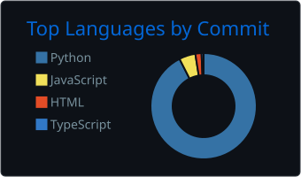
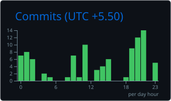

<!-- ═══════════════════════════  HEADER  ═══════════════════════════ -->

 

<table>
<tr>
<td width="60%" valign="top">

I am a **Backend & AI Engineer** and Computer Science student at **REVA University, Bengaluru**. I design APIs, data pipelines and LLM-powered systems, from AI assistants and investigative tools to small utilities that save people time.

- 🔭 &nbsp;Currently building **Zachary** — a desktop assistant with *file memory*
- 🛡️ &nbsp;Built **KAVACH** & **Nishaan** — AI tools for police investigation
- 🏆 &nbsp;Regular at **hackathons** (HackFest 2026 · team *lowcortisol*)
- 🤝 &nbsp;Member of **FACE Club** — Forum of Aspiring Computer Engineers
- 🌱 &nbsp;Exploring **LLM applications, data engineering & system design**
- 📫 &nbsp;Reach me at **samrudhshetty31@gmail.com**

</td>
<td width="40%" align="center">

</td>
</tr>
</table>

### Languages

### Frameworks & Libraries

### Data, Cloud & Tools

<table>
<tr>
<td colspan="2" valign="top">

### 🏆 [WEFT](https://github.com/reshanajk006/weft) &nbsp;
A **deterministic service-dependency blast-radius analyzer**. It ingests Jaeger / OTLP traces, rebuilds the microservice call graph, scores service health and criticality, and **simulates failures**: blast radius, circuit-breaker behaviour, root-cause ranking and mitigation recommendations.

`FastAPI` `SQLite` `NetworkX` `React` `Vite` `Docker`

</td>
</tr>
<tr>
<td width="50%" valign="top">

### 🛡️ [KAVACH](https://github.com/zynssam/KAVACH)
**K**nowledge-based **A**I for **V**erification **A**nd **C**rime **H**andling — a conversational AI over a police crime database, with crime maps and hotspot heatmaps.

`Python` `TypeScript` `React` · [**Live Demo ↗**](https://kavach-vert.vercel.app/)

</td>
<td width="50%" valign="top">

### 🕵️ [Nishaan](https://github.com/zynssam/Nishaan)
AI suspect-sketch & crime-scene generator. A witness's spoken account (Hindi, Kannada or English) becomes a refinable sketch plus a 3D scene layout.

`FastAPI` `React` `Vite` `Gemini` `Groq`

</td>
</tr>
<tr>
<td width="50%" valign="top">

### 🧠 [Zachary](https://github.com/zynssam/Zachary)
A cross-platform desktop assistant with **file memory** — indexes your files, understands what they're about, and finds them by voice or hotkey.

`Python` · *In active development*

</td>
<td width="50%" valign="top">

### 🐞 [BugBash](https://github.com/zynssam/bugbash)
A self-hosted debugging-contest platform: join a round with a code, fix buggy C programs against a timer, climb the leaderboard.

`Node.js` `JavaScript` `C`

</td>
</tr>
<tr>
<td width="50%" valign="top">

### 📋 [Attendance Sheet Maker](https://github.com/zynssam/Attendance-Sheet-Maker)
Generates standardised multi-group `.xlsx` attendance workbooks for FACE Club events and hackathons.

`Python` `HTML` · [**Live App ↗**](https://zynssam.github.io/Attendance-Sheet-Maker/)

</td>
<td width="50%" valign="top">

### 📦 [Supply Chain Reliability](https://github.com/zynssam/Statistical-Modeling-of-Supply-Chain-Reliability)
Simulates logistics data, analyses carrier on-time performance in SQLite, and visualises transit-time variance against SLA targets.

`Python` `SQLite` `Power BI`

</td>
</tr>
</table>

<picture>
  <source media="(prefers-color-scheme: dark)" srcset="https://raw.githubusercontent.com/zynssam/zynssam/output/github-contribution-grid-snake-dark.svg"/>
  <source media="(prefers-color-scheme: light)" srcset="https://raw.githubusercontent.com/zynssam/zynssam/output/github-contribution-grid-snake.svg"/>
  
</picture>

  

